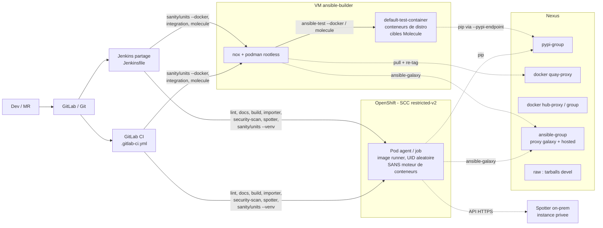

# Proposition : pipeline de test et de validation de collections Ansible, airgap, Jenkins et GitLab CI

*Version 3, 20/10/2026 (v3 : image runner sur la base UBI 9 d'entreprise, §4.1). Les choix ci-dessous s'appuient sur l'[ANALYSE](ANALYSE.md) et ont été **exécutés de bout en bout** sur une collection de démonstration, en airgap simulé (voir §11). La version 2 ajoute : agents OpenShift + VM `ansible-builder` (§16), Molecule optionnel, scanners de sécurité dont Spotter privé (§17), et les réponses aux questions « pourquoi pas Molecule / pourquoi nox / quelles images » (§15).*

## 1. Principes directeurs

1. **La logique vit dans le dépôt de la collection** (`noxfile.py` + `ci/`), sur le modèle d'antsibull-nox / community.general. Jenkins et GitLab ne font qu'appeler `nox -s <session>`. Le même résultat s'obtient en local sur un poste développeur.
2. **`ansible-test` reste le moteur** (sanity / units / integration) avec `--docker`, comme dans 100 % des collections étudiées. On ne réinvente rien, on rend seulement ses dépendances réseau internes.
3. **Rien ne sort sur Internet** : PyPI, images de conteneurs, collections Galaxy, paquets OS passent par **Nexus**. Les outils qui téléchargent depuis GitHub (antsibull-nox et tox-ansible pour ansible-core, ansible-test-gh-action) sont **écartés ou neutralisés**.
4. **Une seule image « runner »**, versionnée, commune aux deux orchestrateurs. ansible-core n'y est **pas** figé : un venv nox est créé par série de la matrice.
5. **Reproductibilité** : versions des outils figées (`ci/constraints.txt`), images ansible-test déduites de la version d'ansible-core installée, artefacts et rapports JUnit publiés.

## 2. Architecture

## 3. Dépôts Nexus à configurer

| Dépôt | Format / type | URL distante | Usage |
|---|---|---|---|
| `pypi-proxy` | PyPI proxy | `https://pypi.org` | ansible-core, ansible-lint, antsibull-*, galaxy-importer, nox, dépendances de tests |
| `pypi-hosted` | PyPI hosted | — | outils internes, wheels patchés |
| `pypi-group` | PyPI group | proxy + hosted | **index unique** : `https://nexus.corp.local/repository/pypi-group/simple` |
| `quay-proxy` | Docker proxy (connecteur dédié, ex. port 8444) | `https://quay.io` | `quay.io/ansible/*-test-container`, `ansible-test-utility-container`, `quay.io/ansible-community/test-image:*` |
| `dockerhub-proxy` | Docker proxy | `https://registry-1.docker.io` | `python`, `docker:cli`, `docker:dind`, images de service (mysql, postgres, vault…) |
| `ghcr-proxy` | Docker proxy (ex. port 8445) | `https://ghcr.io` | images d'aide (ex. `ghcr.io/ansible-collections/*`) |
| `docker-hosted` (+ `docker-group`, ex. port 8443) | Docker hosted / group | — | image runner, images ansible-test dérivées, images molecule internes |
| `ansible-proxy` | **Ansible** proxy (Nexus ≥ 3.93.0) | `https://galaxy.ansible.com` | dépendances de collections |
| `ansible-hosted` | Ansible hosted | — | **publication** des collections internes |
| `ansible-group` | Ansible group | proxy + hosted | résolution unique pour `ansible-galaxy` |
| `debian-proxy`, `ubuntu-proxy` | APT proxy | `http://deb.debian.org/debian`, `http://archive.ubuntu.com/ubuntu` | build des images ; paquets OS installés par les cibles d'intégration |
| `raw-hosted` | Raw | — | tarballs ansible-core `devel`/`milestone` (si testés), binaires kind/helm, etc. |
| `gitlab-registry-proxy` (ex. port 8446) | Docker proxy | `https://registry.gitlab.com` | image helper `gitlab-runner-helper-ocp` pour l'executor Kubernetes sur OpenShift |
| `rpm-proxy` / dépôts BaseOS-AppStream (+ EPEL 9 optionnel) | Yum proxy | dépôts RHEL 9 / UBI 9 | image de base UBI 9 d'entreprise et image runner (`python3.12`/`python3.14` sont dans **AppStream**) ; VM `ansible-builder` (podman, python3.12, python3.14…) ; EPEL seulement si `ShellCheck` en RPM |

Points d'attention Nexus :
* activer les realms **Docker Bearer Token** et **Ansible Galaxy Bearer Token** ([doc Sonatype](https://help.sonatype.com/en/configure-ansible-with-nexus.html)). Le jeton Galaxy Nexus est `base64("user:password")` ;
* le support natif du format Ansible est arrivé avec **Nexus 3.93.0 (04/06/2026)** ([release notes](https://help.sonatype.com/en/sonatype-nexus-repository-3-93-0-release-notes.html)). Sur une version plus ancienne, voir les alternatives du §6 ;
* Docker Engine n'applique `registry-mirrors` qu'à `docker.io`. Pour quay.io et ghcr.io, il faut soit le **re-tag** (§4.2), soit Podman et `registries.conf` (fichier `infra/podman/registries.conf`).

## 4. Stratégie d'images

### 4.1 Image runner (`infra/runner-image/Dockerfile`, détails dans son README)
* **FROM l'image de base d'entreprise UBI 9** : `ARG BASE_IMAGE=nexus.corp.local:8443/corp/ubi9-corp:9.8` (préfixe de registre = placeholder). Elle fournit déjà l'AC interne, `/etc/pip.conf` vers Nexus et les dépôts microdnf internes : l'image runner ne les redéfinit plus.
* **Contrat de la base** : `/etc/pip.conf` global (lu pour tout UID, et seule source d'index pour les venvs `ansible-test --venv`) ; AC dans le magasin système + `REQUESTS_CA_BUNDLE`/`SSL_CERT_FILE` = `/etc/pki/tls/certs/ca-bundle.crt` ; dépôts **BaseOS et AppStream**.
* **Python** : RHEL 9 livre `python3` **3.9** (vérifié : 3.9.25 sur UBI 9.8 — pas 3.10), conservé tel quel. AppStream RHEL 9.8 propose `python3.11` (3.11.13), `python3.12` (3.12.15) et `python3.14` (3.14.8) ; **pas de 3.13**. Pythons contrôleur d'ansible-test (`CONTROLLER_PYTHON_VERSIONS` des branches `stable-*`, cohérents avec `requires-python`) :

  | ansible-core | requires-python | Contrôleur ansible-test | Python retenu (image UBI 9) |
  |---|---|---|---|
  | 2.19 | ≥ 3.11 | 3.11, 3.12, 3.13 | **3.12** |
  | 2.20 | ≥ 3.12 | 3.12, 3.13, 3.14 | **3.14** |
  | 2.21 | ≥ 3.12 | 3.12, 3.13, 3.14 | **3.14** |
  | 2.22 | ≥ 3.13 | 3.13, 3.14, 3.15 | **3.14** |

  Aucun interpréteur ne couvre 2.19 et 2.22 : l'image installe **`python3.12` et `python3.14`** (+ `-pip`), `ARG PYTHON_VERSIONS="3.12 3.14"`. Le noxfile choisit par série le Python contrôleur le plus récent supporté **et présent** (`CONTROLLER_PYTHONS`, surcharge `ANSIBLE_CI_PYTHON_<X_Y>`). Les sessions statiques utilisent celui de la série par défaut (3.14).
* paquets microdnf : `git-core`, `openssh-clients` (ssh-keygen indispensable à ansible-test), `tar`, `gzip`, `findutils`, `rsync`, `jq`, `which`, `diffutils`, `shadow-utils`. **shellcheck absent des dépôts UBI** (paquet `ShellCheck` uniquement dans EPEL 9) → `shellcheck-py` (binaire officiel) depuis le proxy PyPI, `ARG SHELLCHECK_SOURCE=pip|rpm|none`.
* venv `/opt/ansible-ci` en tête du `PATH` : `nox`, `PyYAML`, `shellcheck-py` figés (`requirements.txt`).
* **plus de CLI docker** (aucun moteur dans les pods ; la VM utilise son podman) et **plus de scripts get-pip** : ansible-test crée ses venvs sans pip puis exécute `~/.ansible/test/cache/get_pip_<v>.py`, téléchargé sinon depuis `ci-files.testing.ansible.com` (code `ansible_test/_util/target/setup/requirements.py`). Le noxfile y dépose `ci/get_pip_offline.py` (version lue dans l'ansible-test installé) : `ensurepip` (roue RPM, hors ligne) puis `pip install pip==<v>` depuis Nexus. Le dépôt raw `ansible-ci-files` devient inutile.
* utilisateur `ci` **UID 1001, GID 0**, `HOME=/home/ci` en `chgrp -R 0` + `chmod -R g=u`, `USER 1001` : UID aléatoire OpenShift (validé avec `1000680000:0`).
* Taille : **403 Mo** (dont 174 Mo de base émulée ; 151 Mo compressés) — +62 Mo (+24 Mo compressés) pour `python3.14`, par rapport à la variante 3.12 seule (341 Mo) ; l'ancienne image Debian faisait 347 Mo (141 Mo compressés).
* reconstruite chaque mois (ou via Renovate), poussée dans `docker-hosted` sous un tag daté (`2026.10`).

### 4.2 Images ansible-test : miroir et re-tag (choix retenu)
ansible-test lit ses images dans `ansible_test/_data/completion/docker.txt`. Ce fichier n'est pas surchargeable, et le tag dépend de la version d'ansible-core :

| ansible-core | `default` (collections) | `base` |
|---|---|---|
| 2.19.14 | `quay.io/ansible/default-test-container:11.6.0` | `base-test-container:8.2.0` |
| 2.20.10 | `default-test-container:v2.20-4` | `v2.20-2` |
| 2.21.5 | `default-test-container:v2.21-4` | `v2.21-4` |
| 2.22.0rc1 | `default-test-container:v2.22-8` | `v2.22-8` |

En revanche, **ansible-test ne tire pas une image déjà présente localement** (`docker_util.py` : *« Skipping pull of existing image »*). `ci/prime_images.py` exploite ce comportement :
1. lecture de `docker.txt` dans le venv de la session, donc pour la bonne version d'ansible-core ;
2. `docker pull <ANSIBLE_TEST_IMAGE_MIRROR>/ansible/default-test-container:<tag>` depuis Nexus ;
3. `docker tag … quay.io/ansible/default-test-container:<tag>`.

La sémantique de l'alias `default` est ainsi conservée : sanity et units passent sur **toutes** les versions Python de l'image, 3.9 à 3.14 pour la 2.21. Avec `--docker <image-perso>`, on n'aurait que la version Python du contrôleur.
Le script tire aussi **`ansible-test-utility-container`**. ansible-test l'utilise à chaque exécution `--docker` pour sonder les cgroups et l'audit, puis pour remonter `/sys/fs/cgroup` (`docker run --pid host --privileged … nsenter`, observé dans les logs). Sans lui, même la sanity échoue en airgap.

*Variante Podman* : `registries.conf` avec un miroir pour `quay.io`, `ANSIBLE_TEST_PREFER_PODMAN=1` et `ANSIBLE_TEST_IMAGE_MIRROR` vide. Le re-tag devient alors inutile.

*Variante images dérivées* (`infra/test-images/Dockerfile`) : on ajoute l'AC, `/etc/pip.conf` et les sources APT Nexus à l'image officielle, on la pousse sous `docker-hosted/airgap-quay/ansible/…:<même tag>` et on pointe `ANSIBLE_TEST_IMAGE_MIRROR` dessus. Utile si des cibles d'intégration font de l'`apt` ou si l'on veut se passer de `--pypi-endpoint`.

## 5. pip dans l'airgap (trois niveaux)

| Niveau | Mécanisme | Remarque |
|---|---|---|
| Runner et venvs nox | `PIP_INDEX_URL` (variable CI) + `/etc/pip.conf` | **Ne jamais** déposer `~/.pip/pip.conf` sur le runner : ansible-test refuse de l'écraser hors conteneur géré (*« Refusing to overwrite existing file »*, `pypi_proxy.py`) |
| Conteneurs ansible-test (contrôleur et cibles) | **`--pypi-endpoint <URL>`** (variable `ANSIBLE_TEST_PYPI_ENDPOINT`) | Option masquée (`argparse.SUPPRESS`), mais implémentée et transmise à l'invocation déléguée. ansible-test écrit `~/.pip/pip.conf` (`index-url` + `trusted-host`) dans le conteneur, puis le retire en fin de test |
| Images dérivées (optionnel) | `/etc/pip.conf` intégré à l'image | Indépendant des options d'ansible-test |
| `ansible-test --venv` (pods OpenShift) | `/etc/pip.conf` de l'**image de base UBI 9** **uniquement** | ansible-test **ne transmet pas** `PIP_INDEX_URL` à ses venvs (constaté : pip est parti vers l'index de `/etc/pip.conf`). Amorçage de pip par `ci/get_pip_offline.py` (ensurepip + Nexus, §4.1) |

Constats des essais :
* **sanity** n'installe rien, car les venvs sont pré-construits dans `default-test-container` (`files/prime.py` → `ansible-test sanity --prime-venvs`) ;
* **units `--requirements`** installe `tests/unit/requirements.txt` **dans le conteneur**. Sans `--pypi-endpoint`, pip part vers `pypi.org` et échoue en airgap ; avec, ça passe. Les deux cas ont été testés ;
* **integration** installe au minimum `requirements/ansible.txt` dans le conteneur contrôleur ;
* `PIP_INDEX_URL` défini dans le job **n'est pas propagé** dans les conteneurs ansible-test ;
* `trusted-host` est posé sur l'hôte de l'index, ce qui **désactive la vérification TLS** pour cet hôte dans les conteneurs de test. C'est acceptable pour un Nexus interne. Sinon, passer aux images dérivées avec l'AC.

## 6. Collections Galaxy (dépendances et publication)

* `ci/ansible.cfg`, passé **uniquement** à `ansible-galaxy` via `ANSIBLE_CONFIG` pour ne pas perturber ansible-test : `server_list = nexus_group, nexus_hosted`.
* Jetons hors du dépôt : `ANSIBLE_GALAXY_SERVER_<NOM>_TOKEN`, ou `_USERNAME` / `_PASSWORD` pour une auth basique. Mécanisme vérifié dans `ansible/config/manager.py`.
* Les dépendances (`galaxy.yml: dependencies`, `tests/requirements.yml`, `tests/unit/requirements.yml`, `tests/integration/requirements.yml`, les conventions observées) sont installées **dans la même racine `ansible_collections`** que la collection, et ansible-test les embarque.
* Publication : `ansible-galaxy collection publish dist/<ns>-<name>-<ver>.tar.gz --server nexus_hosted`. `--server` accepte un **nom** de `server_list`, vérifié dans `ansible/cli/galaxy.py`.
* Alternatives si Nexus < 3.93 : **Private Automation Hub** (galaxy_ng) ; ou bien tarballs vendus dans un dépôt Nexus *raw* puis `ansible-galaxy collection install <fichier>.tar.gz --offline` (sur des tarballs **locaux**, `--offline` évite tout appel à un serveur de distribution ; l'option ne s'applique ni aux URL distantes ni aux dépôts Git) ; ou encore miroirs Git internes des collections (`git+https://gitlab.corp.local/…`, à la manière des `collection_sources` d'antsibull-nox).

## 7. Étapes du pipeline

| Étape | Session nox | Outils / commande | MR | main / stable-* | tag | nightly |
|---|---|---|---|---|---|---|
| Lint | `lint` | `yamllint --strict` ; `antsibull-changelog lint` ; `ansible-lint --offline` (pas d'installation `requirements.yml` ni de rafraîchissement de schémas) | ✔ | ✔ | ✔ | ✔ |
| Docs | `docs` | `antsibull-docs lint-collection-docs --plugin-docs` | ✔ (non bloquant) | ✔ | ✔ | ✔ |
| Build | `build` | `ansible-galaxy collection build --force --output-path dist` | ✔ | ✔ | ✔ | ✔ |
| Validation import | `galaxy-importer` | `python -m galaxy_importer.main dist/*.tar.gz` (`CHECK_REQUIRED_TAGS`, ansible-lint hors ligne, `RUN_ANSIBLE_TEST=False`) | ✔ | ✔ | ✔ | ✔ |
| Sanity rapide (pod) | `sanity-<X.Y>` + `ANSIBLE_TEST_MODE=venv` | `ansible-test sanity --venv --python <3.12 pour 2.19, 3.14 sinon> --requirements --junit` | ✔ | ✔ | ✔ | ✔ |
| Sanity complète (VM) | `sanity-<X.Y>` | `ansible-test sanity --docker default --junit -v --color --pypi-endpoint …` (podman) | | ✔ | ✔ | ✔ |
| Units rapides (pod) | `units-<X.Y>` + `ANSIBLE_TEST_MODE=venv` | `ansible-test units --venv --python <3.12 / 3.14> --requirements` | ✔ | ✔ | ✔ | ✔ |
| Units complètes (VM) | `units-<X.Y>` | `ansible-test units --docker default --requirements …` | | ✔ | ✔ | ✔ |
| Intégration | `integration-<X.Y>` | `ansible-test integration --docker <default|ubuntu2404|fedora43…> --retry-on-error --continue-on-error [--docker-network N]` | ✔ (défaut) | ✔ (+ distros) | ✔ | ✔ + `ANSIBLE_TEST_COVERAGE=1` |
| Intégration / Molecule : agent | | VM `ansible-builder` (podman rootless) | | | | |
| Molecule (option, VM) | `molecule` | `molecule test --all` (ansible-native, `extensions/molecule`, cibles podman) ; ignorée sans `extensions/molecule` | ✔ si présent | ✔ | ✔ | ✔ |
| Sécurité (pod) | `security-scan` | `ansible-security-scanner` : SARIF + JUnit (+ GitLab SAST) ; **bloquant** sur HIGH/CRITICAL | ✔ | ✔ | ✔ | ✔ |
| Sécurité (pod) | `spotter` | `spotter scan` vers l'**instance privée** (`SPOTTER_ENDPOINT`) ; non bloquant au départ | ✔ | ✔ | ✔ | ✔ |
| Publication | `publish` | `ansible-galaxy collection publish … --server nexus_hosted` | | | ✔ | |

Rapports : ansible-test écrit tout dans `tests/output/` (JUnit : `tests/output/junit/*.xml`. sanity avec `--junit`, units via `pytest --junit-xml`, integration via le callback `junit` activé d'office). Le noxfile copie ce répertoire dans `reports/<session>/`, que GitLab (`artifacts:reports:junit`) et Jenkins (`junit 'reports/**/junit/*.xml'`) publient.

## 8. Matrice de versions

* **Par défaut : ansible-core 2.19, 2.20, 2.21 et 2.22** (dernières versions : 2.19.14, 2.20.10, 2.21.5, 2.22.0rc1).
* **2.22** est en RC : `ANSIBLE_CORE_PRERELEASE="2.22"` (défaut du noxfile, Jenkinsfile et `.gitlab-ci.yml`) installe `ansible-core>=2.22.0a0,<2.23` — le spécificateur à pré-version n'autorise les pré-versions **que** pour ansible-core (pas de `--pre` global ; `>=2.22` seul exclurait 2.22.0rc1). Les sessions statiques restent sur la dernière série non RC (2.21). À la GA : vider `ANSIBLE_CORE_PRERELEASE`.
* **2.22 en mode `--venv`** : l'exigence sanity `pylint` contient `dill @ https://github.com/uqfoundation/dill/archive/…zip` (en attendant une version de dill compatible 3.15), impossible à servir par Nexus PyPI. Le noxfile **détecte** ces exigences par URL et ignore le test (`--skip-test pylint`, avertissement) ; pylint 2.22 tourne en mode docker, où `default-test-container:v2.22-8` contient le venv `sanity.pylint` pré-construit (dill 0.4.2.dev0, Python 3.15 — constaté dans l'image ; exécution docker 2.22 non rejouée). `ANSIBLE_TEST_VENV_URL_REQS=allow` désactive le contournement.
* `devel` / `milestone` ne sont pas publiés sur PyPI. Il faut fournir un tarball interne via `ANSIBLE_CORE_SRC_DEVEL` (dépôt Nexus raw alimenté par un job de synchronisation), sinon on s'en passe.
* Les axes Python sont couverts par l'image `default` : inutile de les multiplier dans Jenkins ou GitLab. Pour cibler une version : `nox -s units-2.21 -- --python 3.12`.
* Tenir à jour `meta/runtime.yml: requires_ansible` et un `tests/sanity/ignore-2.X.txt` par série.

## 9. Accès au moteur de conteneurs

Résumé (détails §16) : **aucun moteur de conteneurs dans les pods OpenShift** ; tout ce qui en a besoin
(`ansible-test --docker`, `integration`, `molecule`) va sur la **VM `ansible-builder` avec podman rootless**.

| Option | GitLab | Jenkins | Avis |
|---|---|---|---|
| **VM + podman rootless** (retenu) | executor `shell`, tag `ansible-builder` | agent label `ansible-builder` | **Validé** (sanity/units/integration/molecule). ansible-test détecte podman ; `ANSIBLE_TEST_PREFER_PODMAN=1` le force. Prérequis : subuid/subgid, `loginctl enable-linger`, délégation cgroup v2 (§16.3) |
| Socket Docker de l'hôte | executor docker + socket (template `.docker-socket`) | agent docker | Fonctionne (validé en v1) mais = root sur l'hôte ; exclu sur OpenShift |
| Docker-in-Docker | service `docker:dind` privileged | rare | Exige `privileged` : exclu sur OpenShift |
| Podman imbriqué dans un pod (OCP ≥ 4.20, `nested-container`) | executor kubernetes | pod template | POC à mener (§16.4) |

## 10. Cache et artefacts
* **Nexus est le cache principal** (PyPI, images, collections).
* GitLab : cache `.cache/pip` par job, `pull_policy = if-not-present` pour l'image runner. Jenkins : les images restent sur l'agent, `nox -R` réutilise les venvs dans un même workspace.
* Artefacts : `dist/*.tar.gz` (30 j), `reports/**` (JUnit, `importer_result.json`, sorties ansible-test, couverture XML si `ANSIBLE_TEST_COVERAGE=1`).

## 11. Validation réalisée
**v1 (docker, airgap simulé)** — collection `corp.demo`, dans l'image runner : Nexus simulé par un registre pull-through quay.io (`registry:2`) et un proxy PyPI devpi, egress des conteneurs coupé (`DOCKER-USER`) : `lint`, `build`, `galaxy-importer`, `docs`, `sanity-2.21` (Python 3.9 → 3.14), `units-2.21`, `integration-2.21`, `sanity-2.19` OK ; test négatif `--pypi-endpoint` concluant.

**v3.1 (20/10/2026)** — image avec `python3.12` + `python3.14`, matrice 2.19 → 2.22, même banc (UID `1000680000:0`, réseau coupé sauf faux Nexus) : `lint`, `docs`, `build`, `galaxy-importer`, `security-scan`, `spotter` (export) sur Python 3.14 ; `sanity`/`units` en `--venv` : 2.19 sur 3.12, 2.20/2.21/2.22 sur 3.14 — **tous OK** (2.22 : `pylint` ignoré automatiquement, voir §8). Jenkinsfile revalidé (Jenkins 2.580.1), `.gitlab-ci.yml` revalidé (schéma).

**v3 (20/10/2026) — image runner UBI 9** : base émulée (`ubi9/ubi-minimal` 9.8 + python3 3.9 + AC de test + `/etc/pip.conf`), conteneur `--user 1000680000:0 --cap-drop ALL --security-opt no-new-privileges`, réseau **interne** sans route ni DNS externe (connexion Internet testée : « Network is unreachable »), seul joignable : un faux `nexus.corp.local` en HTTPS signé par l'AC de test (devpi pour PyPI + émulation statique Galaxy v3 pour `containers.podman`). Aucun `PIP_INDEX_URL` : seul `/etc/pip.conf` de la base sert. Résultats : `lint`, `docs`, `build`, `galaxy-importer`, `security-scan`, `spotter` (export), `sanity-2.19/2.20/2.21` et `units-2.19/2.20/2.21` en `--venv` (Python 3.12, test shellcheck exécuté) **tous OK** ; pip 24.2 / 25.2 amorcés par `get_pip_offline.py` sans Internet.

**v2 (20/10/2026)** — collection `corp.demo` enrichie d'un rôle `motd` et de scénarios Molecule :
* **VM `ansible-builder` simulée** (podman 5.4.2 **rootless**, cgroup v2 délégué) : `lint`, `docs`, `build`, `galaxy-importer`, `security-scan`, `spotter` (export), `molecule` (2 cibles systemd Ubuntu 24.04 + Fedora 43, converge/idempotence/verify), `sanity-2.21`, `units-2.21`, `integration-2.21` **tous OK** avec `ANSIBLE_TEST_PREFER_PODMAN=1` ;
* **pod OpenShift simulé** (image runner, UID 54321:0 absent de `/etc/passwd`, `--cap-drop ALL`, `no-new-privileges`, aucun moteur) : `lint`, `docs`, `build`, `galaxy-importer`, `security-scan`, `spotter` (export), `sanity`/`units` **2.19, 2.20, 2.21 en `--venv`** OK ; `integration` et `molecule` refusés proprement (message vers l'agent VM) ;
* **`Jenkinsfile` validé** par `pipeline-model-converter/validate` sur Jenkins 2.580.1 + plugin kubernetes 4560.vc25b_83890c34 (test négatif : une option inconnue est bien rejetée) ;
* `.gitlab-ci.yml` validé contre le schéma GitLab (`check-jsonschema --builtin-schema vendor.gitlab-ci`) ; pods (`jenkins-agent-pod.yaml`, POC imbriqué) validés contre le schéma Kubernetes `pod-v1` strict ; `config.toml.example` parsé (TOML) ; playbook de la VM : `--syntax-check` + `ansible-lint` profil `production` ;
* **Spotter** : flux réseau vérifié — avec `SPOTTER_ENDPOINT=https://spotter.corp.local/api` la CLI n'appelle que cet hôte (`/api/v3/auth/verify/`…) ; `--export-payload` fonctionne sans réseau (exécuté dans un namespace réseau vide) ;
* non validé : exécution sur un vrai cluster OpenShift et contre une vraie instance Spotter.

## 12. Pièges identifiés (✔ = rencontré pendant les essais)

1. ✔ **Arbre de travail dans le dépôt git** : si `ansible_collections/<ns>/<name>` est créé sous le dépôt (ex. `.nox/`), ansible-test remonte jusqu'au `.git` parent, liste les fichiers via git (ignorés) et affiche *« WARNING: All targets skipped »* **en sortant en succès**. Le noxfile travaille donc dans `$TMPDIR/ansible-ci-<repo>` (`ANSIBLE_CI_WORKDIR`).
2. ✔ **`--network host` sur le conteneur du job** : ansible-test réutilise ce réseau pour ses conteneurs et plante (*« Missing IP address for container »*). Utiliser le réseau bridge par défaut ou un réseau dédié.
3. ✔ **`ssh-keygen` absent** du runner : *« Required program "ssh-keygen" not found »*.
4. ✔ **`ansible-test-utility-container`** non mis en miroir : toute exécution `--docker` en a besoin.
5. ✔ **Shebang dans un script `.py` non-module** du dépôt (ex. `ci/*.py`) : test sanity `shebang` en échec. Les scripts CI sont inclus dans la sanity.
6. Les **tags d'images changent avec les versions correctives** d'ansible-core (ex. `v2.21-3` → `v2.21-4`). Le script les lit dynamiquement. Pour figer, épingler la version corrective d'ansible-core.
7. **antsibull-nox / tox-ansible / ansible-test-gh-action** téléchargent ansible-core depuis GitHub (`archive/stable-X.Y.tar.gz`). Ne pas les utiliser tels quels en airgap. Avec antsibull-nox, il faudrait passer `ansible_core_source="pypi"` par l'API Python, car le TOML ne l'expose pas.
8. **ansible-lint sans `--offline`** tente d'installer les `requirements.yml` et de rafraîchir les schémas.
9. Les **`--remote`** (VM Red Hat Core CI) n'existent pas on-prem. Les remplacer par des conteneurs de distribution, ou par des VM internes (`ansible-test integration --target ssh:<user>@<host>[:<port>]`, syntaxe vérifiée dans `ansible-test integration --help`).
10. **Cibles d'intégration** qui font `apt`/`dnf`/`pip` : prévoir les images dérivées (APT/DNF vers Nexus) ou des rôles `setup_*` configurables.
11. **Socket Docker = root sur l'agent** : réserver des runners/agents dédiés et éphémères. ansible-test lance un conteneur `--privileged --pid host` (sonde cgroup).
12. **`build_ignore`** dans `galaxy.yml` : exclure `ci/`, `noxfile.py`, `Jenkinsfile`, `.gitlab-ci.yml`, `reports/`, `dist/` de l'artefact.
13. **galaxy-importer** écrit `importer_result.json` dans le répertoire courant. Le noxfile l'exécute dans `reports/galaxy-importer/`.
14. ✔ **podman rootless sans délégation cgroup** : les conteneurs ansible-test (systemd) meurent au démarrage (*« Failed to create /init.scope control group: Permission denied »*, puis *« can only create exec sessions on running containers »*). Corrigé en donnant à l'utilisateur un sous-arbre cgroup v2 délégué (session systemd : `loginctl enable-linger`).
15. ✔ **`ansible-test --venv` en airgap** : télécharge `get-pip-<v>.py` depuis `ci-files.testing.ansible.com` et ignore `PIP_INDEX_URL` → `ci/get_pip_offline.py` déposé par le noxfile + `/etc/pip.conf` (§4.1, §5).
20. ✔ **Script Python avec shebang dans `ci/`** : le test sanity `shebang` le refuse (vu avec `get_pip_offline.py`) ; pas de shebang pour les scripts appelés par `python`.
21. **UBI 9** : `python3` = 3.9 ; AppStream a 3.11, 3.12 et 3.14 mais **pas 3.13** (2.19 → 3.12, 2.20+ → 3.14) ; pas de ShellCheck hors EPEL ; chemin AC = `/etc/pki/tls/certs/ca-bundle.crt` (pas `/etc/ssl/certs/ca-certificates.crt` de Debian), corrigé dans `SPOTTER_CACERT`.
16. ✔ **ansible-security-scanner n'a pas d'option d'exclusion** : lancé à la racine, il analyse `.nox/` (286 fichiers au lieu de 21). Le noxfile scanne une copie propre.
17. ✔ **galaxy-importer** exige un `README.md` par rôle ; **antsibull-docs** exige `description` dans `meta/argument_specs.yml` (erreurs réelles détectées sur la démo).
18. ✔ **Spotter CLI 6.6.0** : `--ansible-version` n'accepte que 2.0 → 2.20 (`SPOTTER_ANSIBLE_VERSION`, défaut 2.20) ; code retour 1 dès qu'un résultat reste après filtrage `--display-level` (défaut retenu : `error`).
19. ✔ **Faux positif ansible-security-scanner** (règle `linux_cap_bpf_granted_to_container_or_service` déclenchée par `podman_container` + `systemd`) : suppression ciblée `# nosec: <rule_id> reason="…"` (un `# nosec` nu ne supprime rien).

## 13. Sécurité et SBOM
* Scanners Ansible intégrés au pipeline : **§17** (ansible-security-scanner local, Steampunk Spotter sur instance privée).
* Profil `ansible-lint` `production` (atteint par la démo), `CHECK_REQUIRED_TAGS`.
* Nexus Firewall / IQ (ou « Pro+ » 3.97) sur les dépôts proxy. Chaîne d'approvisionnement : versions figées (`constraints.txt`), images runner datées.
* SBOM de l'artefact (ex. `syft dist/*.tar.gz`) et `pip-audit` sur `tests/unit/requirements.txt`, en jobs non bloquants.
* Signature des collections (GPG + `ansible-galaxy collection verify`) si un Automation Hub privé est utilisé.

## 14. Mise en œuvre proposée
1. Créer les dépôts Nexus du §3 (dont `gitlab-registry-proxy` et le proxy yum AppStream) et activer les realms.
2. Construire l'image runner `FROM ubi9-corp:9.8` et la pousser ; préparer une VM `ansible-builder` avec `infra/ansible-builder-vm/site.yml`.
3. OpenShift : namespace `ci-ansible`, ServiceAccount des agents, cloud Kubernetes Jenkins / runner GitLab Kubernetes (`infra/openshift`, `infra/gitlab-runner`).
4. Copier `collection-files/` dans une collection pilote ; `galaxy.yml: build_ignore` ; `.yamllint`.
5. Brancher les credentials : jeton Nexus Galaxy (publication), **jeton Spotter** de l'instance privée.
6. Activer dans l'ordre : statique + venv (pod) → integration/molecule (VM) → sanity complète sur main/nightly → publication sur tag → 2.22 bloquante à sa GA. Passer Spotter en bloquant après calibrage.
7. Industrialiser : `include: project:` GitLab et Shared Library Jenkins ; le noxfile reste dans chaque dépôt.
8. POC séparé : podman imbriqué sur OpenShift 4.20 (`nested-container`), pour éventuellement supprimer la VM.

## 15. Questions fréquentes

### 15.1 Pourquoi Molecule n'est-il pas le moteur principal ? Est-il abandonné ?
**Non, Molecule n'est ni abandonné ni déprécié.**
* Dépôt [ansible/molecule](https://github.com/ansible/molecule/releases) très actif : v26.10.0 le 12/10/2026, une version par mois environ (26.2 → 26.10 en 2026). Molecule fait partie d'[ansible-dev-tools](https://pypi.org/project/ansible-dev-tools/) (26.10.0 du 12/10/2026), la boîte à outils de développement maintenue par Red Hat.
* Ce qui a changé : depuis **Molecule 25.9.0 (15/09/2025)**, la configuration **« ansible-native »** est la voie recommandée ([doc](https://docs.ansible.com/projects/molecule/configuration/)) : plus de *driver*, des playbooks `create.yml`/`destroy.yml` écrits avec des collections normales (`containers.podman`, `amazon.aws`…), l'inventaire Ansible natif, la découverte des scénarios dans `extensions/molecule/` des collections, `shared_state`. Les drivers docker/podman/vagrant/… vivent dans [molecule-plugins](https://pypi.org/project/molecule-plugins/) (26.10.12) et sont documentés comme [« pre ansible-native »](https://docs.ansible.com/projects/molecule/pre-ansible-native/). Constat sur 26.10.0 : `molecule test --help` ne propose plus que `-d [default]`.
* **ansible-test et Molecule ne testent pas la même chose** :

| | ansible-test | Molecule |
|---|---|---|
| Cible | plugins/modules d'une collection | rôles, playbooks, scénarios multi-nœuds |
| Tests | sanity (exigée par Galaxy / Automation Hub / certification), units, cibles d'intégration | converge → **idempotence** → verify sur de vrais OS |
| Environnement | images officielles maîtrisées (matrice Python) | ce que l'on crée (conteneurs systemd, VM, cloud, équipements) |

* **Usage réel** (ANALYSE §1) : **4 des 23 collections étudiées**. community.zabbix et community.grafana pour leurs **rôles** ; cisco.ios et ansible.scm comme harnais d'intégration. Aucune ne remplace ansible-test par Molecule.
* **Recommandation** : ansible-test reste obligatoire ; **Molecule en étape optionnelle** dès qu'il y a des rôles, du multi-nœuds, du systemd ou de l'idempotence à prouver. Implémenté : session `molecule` (ignorée sans `extensions/molecule`), exécutée sur la VM `ansible-builder` en podman rootless, scénarios ansible-native (`exemple-collection/corp.demo/extensions/molecule`). Les cibles réutilisent les **images de distribution ansible-test** déjà en miroir (systemd inclus), tirées du Nexus par la session.

### 15.2 Pourquoi nox (et pas tox, tox-ansible, make, ansible-content-actions, ansible-dev-tools) ?

| Option | Pour | Contre en airgap Jenkins + GitLab | Verdict |
|---|---|---|---|
| **nox + noxfile maison** (retenu) | Python pur : matrice générée, sessions paramétrées, logique conditionnelle (images, `--pypi-endpoint`, venv/docker) ; même commande en local et dans les deux CI ; tout réseau passe par `pip`/Nexus | ~400 lignes à maintenir nous-mêmes | Retenu |
| **antsibull-nox** (community.general, .docker, .crypto, .dns, .routeros, .sops…) | Standard de la communauté, très riche (extra-checks, docs, licences, matrice) ; même modèle que notre choix | ansible-core installé **depuis les archives GitHub** par défaut (`ansible_core_source="git"`, réglable seulement via l'API Python) ; dépendances de collections souvent en git | **Meilleur choix hors airgap**. À réévaluer si la source PyPI devient configurable dans `antsibull-nox.toml` ; notre noxfile en reprend les conventions pour faciliter une migration |
| **tox + tox-ansible** (amazon.aws, ansible.scm, collections réseau) | Matrice auto depuis `galaxy.yml`, intégré à ansible-dev-tools | Installe ansible-core par `ade install --acv stable-X.Y` depuis `https://github.com/ansible/ansible/archive` (variable `ANSIBLE_CORE_REPO_URL`, redirigeable en théorie vers un proxy raw Nexus — **non testé**) ; logique moins scriptable | Alternative crédible si l'on veut s'aligner sur Red Hat |
| **ansible-content-actions** | Workflows prêts à l'emploi | **GitHub Actions uniquement** | Inutilisable ici |
| **ansible-dev-tools** (adt / ade) | Bon environnement de dev (ansible-lint, molecule, ansible-creator, tox-ansible, pytest-ansible) | Pas un orchestrateur CI ; ade cible GitHub pour ansible-core | Bien pour les postes, pas pour la CI |
| **make / scripts shell** | Simple | Pas de gestion de venv ni de matrice ; divergence local/CI | Seulement pour un très petit périmètre |

### 15.3 Que contiennent les images ansible-test pré-chargées ?
Elles sont **choisies par ansible-test**, pas par nous : `ansible_test/_data/completion/docker.txt` associe des alias aux images. Chaque version d'ansible-core a ses tags. `ci/prime_images.py` lit ce fichier dans le venv de la session.

| Famille | Contenu | Utilisée par | Taille amd64 (compressée ; décompressée) |
|---|---|---|---|
| `base-test-container` | Ubuntu, **toutes les versions Python** supportées (3.9 → 3.14 pour 2.21), PowerShell 7.6, systemd, sshd, outils de build | base des deux suivantes ; alias `base` | `v2.21-4` : 462 Mo |
| `default-test-container` | base + **requirements sanity/units pré-installés** par version de Python (venvs `sanity.*` amorcés par `prime.py`, `get_pip_25_2.py` en cache) | `--docker default` pour une **collection** (`context=collection`) | `v2.21-4` : 565 Mo ; **1,55 Go** (Ubuntu 24.04.4 constaté au boot) |
| `ansible-core-test-container` | idem, réglé pour tester ansible-core lui-même | `context=ansible-core` (inutile ici) | — |
| `ubuntu-test-container`, `fedora-test-container`, `alpine-test-container` | une distribution, **une** version de Python, systemd (sauf alpine) | `integration --docker ubuntu2404 / fedora43 / alpine323…`, cibles Molecule | Ubuntu 24.04 : 242 Mo ; 666 Mo — Fedora 43 : 252 Mo ; 653 Mo — Alpine 3.23 : 158 Mo |
| `ansible-test-utility-container` | utilitaires de sonde (audit, cgroup) | **chaque** exécution `--docker` | 4 Mo ; 9 Mo |
| `http-test-container` / `pypi-test-container` / `acme-test-container` | serveur HTTP de test, proxy PyPI, ACME | cibles `needs/httptester`, `--pypi-proxy`, plugin cloud ACME | 33 Mo / 33 Mo / — |

Tags par version d'ansible-core (relevés le 20/10/2026 sur les branches `stable-*`) :

| ansible-core | default / base | Ubuntu / Fedora / Alpine | utility |
|---|---|---|---|
| 2.19 | `default-test-container:11.6.0` / `base:8.2.0` (Python 3.8 → 3.13) | `ubuntu2204/2404-test-container:9.0.0`, `fedora41-…:9.0.0`, `alpine321-…:9.1.0` | 3.2.0 |
| 2.20 | `v2.20-4` / `v2.20-2` (3.9 → 3.14) | `ubuntu-test-container:24.04-v2.20-1`, `fedora-…:42-v2.20-1`, `alpine-…:3.22-v2.20-1` | 3.4.0 |
| 2.21 | `v2.21-4` / `v2.21-4` (3.9 → 3.14) | `24.04-v2.21-2`, `fedora 43-v2.21-2`, `alpine 3.23-v2.21-2` | 3.5.0 |
| 2.22 | `v2.22-8` / `v2.22-8` (3.9 → 3.15) | `24.04-v2.22-4`, `26.04-v2.22-4`, `fedora 44-v2.22-4`, `alpine 3.24-v2.22-4` | — |

Budget Nexus indicatif pour 3 séries : environ 2,5 Go compressés (3 × default + 2 distributions + utilitaires). Sources : [base-test-container](https://github.com/ansible/base-test-container), [default-test-container](https://github.com/ansible/default-test-container), API `quay.io/v2`.

## 16. Agents : OpenShift (pods) + VM `ansible-builder` (podman)

### 16.1 Répartition
| Étape | Pod OpenShift (restricted-v2) | VM `ansible-builder` |
|---|---|---|
| lint, docs, build, galaxy-importer, publish | ✔ | |
| security-scan, spotter | ✔ | |
| sanity / units **rapides** (`--venv`, Python 3.12 ou 3.14 de l'image selon la série) | ✔ (MR) | |
| sanity / units **complètes** (`--docker default`, Python 3.9 → 3.14) | | ✔ (main, tags, nightly) |
| integration (`--docker`), Molecule | | ✔ |

### 16.2 `--venv` contre `--docker` : la fidélité
* `--venv` : une seule version de Python (celle de l'agent) ; `compile`/`import` ne couvrent pas 3.9 → 3.12 ; `pslint` ignoré sans `pwsh` ; dépendances de tests installées depuis Nexus à chaque job (pas de venvs pré-amorcés). Rapide et sans privilège : parfait pour les MR.
* `--docker default` : environnement de référence (celui de Galaxy, de la certification et des collections communautaires), toutes les versions de Python. C'est le **seul** à faire foi avant publication : la sanity complète est donc exigée sur `main`, sur les tags et la nuit.

### 16.3 VM `ansible-builder` : podman rootless (validé)
* ansible-test cherche `docker` puis `podman` (`DOCKER_COMMANDS`), ignore un `docker` qui n'est qu'un alias de podman ; `ANSIBLE_TEST_PREFER_PODMAN=1` inverse l'ordre.
* Les conteneurs de test démarrent systemd (`--systemd always --cgroupns private`) : il faut une **délégation cgroup v2** à l'utilisateur CI (session systemd utilisateur, `loginctl enable-linger`), des plages `/etc/subuid`/`/etc/subgid`, et `XDG_RUNTIME_DIR` pour les jobs lancés sans session logind (runner GitLab `shell`).
* Préparation automatisée : `infra/ansible-builder-vm/site.yml` (podman, python3.14 + python3.12, AC, `/etc/pip.conf`, `registries.conf` Nexus, linger, venv `/opt/ansible-ci` avec nox sur 3.14).
* Une VM est un point unique : en prévoir 2 (labels identiques) et dimensionner les exécuteurs (un job = 2 à 3 conteneurs ; `default-test-container` occupe 1,55 Go).

### 16.4 Options pour se passer de la VM sur OpenShift
| Option | Statut | Évaluation |
|---|---|---|
| Socket hôte / DinD / `privileged` | Interdits par les SCC | Exclu |
| **Podman imbriqué avec user namespaces** (`hostUsers: false`, SCC `nested-container`) | **GA en OCP 4.20** ([release notes](https://docs.redhat.com/en/documentation/openshift_container_platform/4.20/html/release_notes/ocp-4-20-release-notes)), Technology Preview en 4.19 | Piste la plus réaliste. ansible-test lance un conteneur `--privileged --pid host` et des conteneurs systemd : **POC indispensable** (`infra/openshift/nested-podman-pod.poc.yaml`, non validé) |
| buildah | — | Construit des images, ne lance pas de conteneurs de test : hors sujet |
| OpenShift sandboxed containers (Kata) | Produit supporté | Pods dans des micro-VM : il faut des nœuds bare-metal ou la virtualisation imbriquée ; lourd pour de la CI |
| `ansible-test integration --venv/--local` dans le pod | Possible | Seulement pour des cibles qui ne modifient pas le système (API, réseau) |

### 16.5 GitLab
* Runner **Kubernetes sur OpenShift** (tag `openshift`, défaut des jobs) : `privileged = false`, `allow_privilege_escalation = false`, `cap_drop = ["ALL"]`, `run_as_non_root`, helper `gitlab-runner-helper-ocp` depuis Nexus (`infra/gitlab-runner/config.toml.example`). L'opérateur GitLab Runner certifié OpenShift est une alternative au déploiement manuel.
* Runner **shell sur la VM** (tag `ansible-builder`) : template `.ansible-builder` (pas d'image, nox dans `/opt/ansible-ci`).

### 16.6 Jenkins partagé
* Pods via le plugin Kubernetes : `yamlFile 'ci/jenkins-agent-pod.yaml'` (conteneurs `jnlp` + `runner`, mêmes UID car fixés par OpenShift au niveau du pod). Pour un Jenkins partagé, le modèle peut être défini **centralement** et référencé par `inheritFrom`. Le plugin crée un pod par exécution : l'élasticité vient du cluster (quotas du namespace).
* VM : agent label `ansible-builder`, nox appelé par `/opt/ansible-ci/bin/nox`.
* Matrices : pod `ANSIBLE_CORE × {sanity, units}` en venv ; VM `ANSIBLE_CORE × {sanity, units, integration}` (sanity/units seulement sur main, tags et nightly).

## 17. Scanners de sécurité

### 17.1 « ansible-security-scanner » — identification
* Le nom correspond exactement au paquet PyPI [**ansible-security-scanner**](https://pypi.org/project/ansible-security-scanner/) (0.1.41 du 25/08/2026, Apache-2.0, dépôt [cpeoples/ansible-security-scanner](https://github.com/cpeoples/ansible-security-scanner)) : analyse statique des YAML (playbooks, rôles, collections), **1 165 motifs** (31 fichiers) d'après l'outil lui-même, sorties SARIF / JUnit / GitLab SAST / CycloneDX. Retenu comme candidat le plus probable.
* **Incertitude** : projet jeune (créé le 29/04/2026), **un seul mainteneur** (125 commits), 11 étoiles, versions 0.1.x. Autres outils possibles derrière ce nom générique : [KICS](https://github.com/Checkmarx/kics) (Checkmarx, requêtes Ansible, v2.2.0 du 17/09/2026, binaire/conteneur), [ansible-risk-insight](https://pypi.org/project/ansible-risk-insight/) (0.2.11), les règles de sécurité d'ansible-lint. À confirmer avec l'équipe sécurité.
* **Verdict airgap : ✅ 100 % local.** Dépendances `httpx`, `jinja2`, `pyyaml`. Seules les options `--github-comment` / `--gitlab-comment` font des appels réseau (API GitLab interne via `CI_SERVER_URL`). Exécuté dans un namespace réseau vide : OK.
* Intégration (`nox -s security-scan`) : copie propre de la collection (pas d'option d'exclusion), SARIF + GitLab SAST en `--exit-zero`, puis passe JUnit **bloquante** (code ≠ 0 si HIGH/CRITICAL ; `--severity` ne filtre que l'affichage). Sur la démo, un faux positif a été supprimé par `# nosec: <rule_id> reason="…"`. Sur community.sops : 25 constats dont 1 CRITICAL a priori faux positif (bindep). Prévoir une phase de calibrage et une allowlist (`--allowlist`).

### 17.2 Steampunk Spotter — instance privée
* CLI [**steampunk-spotter**](https://pypi.org/project/steampunk-spotter/) 6.6.0 (14/10/2026), installée depuis le proxy PyPI Nexus (`ci/requirements-security.txt`, version figée).
* **L'analyse se fait côté serveur** : la CLI extrait tâches et métadonnées puis les envoie à l'API. Sans serveur, seul `--export-payload` fonctionne (*« this operation is fully offline. No actual scan was executed »*).
* **Verdict airgap : ✅ faisable avec l'instance Spotter on-prem** ([installation on-prem](https://spotter.steampunk.si/docs/onprem/), conçue pour l'airgap : installeur avec podman portable, licence, LDAP, TLS d'entreprise). ❌ Impossible avec le SaaS.
* Configuration vérifiée dans le code de la CLI (`spotter/client/utils.py`) :

| Besoin | Option / variable |
|---|---|
| Endpoint privé | `--endpoint` ou **`SPOTTER_ENDPOINT`** (ex. `https://spotter.corp.local/api`) ; sinon `~/.config/steampunk-spotter/spotter.json`, puis le SaaS par défaut |
| Jeton | `--token` ou **`SPOTTER_TOKEN`** (alias `SPOTTER_API_TOKEN`) ; ou `SPOTTER_USERNAME`/`SPOTTER_PASSWORD` |
| AC interne | `--cacert` ou **`SPOTTER_CACERT`** (le noxfile/pipelines pointent sur le bundle système) ; `-k`/`SPOTTER_INSECURE` à proscrire |
| Proxy HTTP | la CLI utilise `requests` : `HTTPS_PROXY`/`NO_PROXY` standards s'appliquent si nécessaire |
| Version ciblée | `--ansible-version` limité à 2.0 → 2.20 dans la CLI 6.6.0 → `SPOTTER_ANSIBLE_VERSION=2.20` |
| Rapports | `--junit-xml`, `--sarif` ; `--display-level error` ; code retour 1 s'il reste des résultats |

* **Flux réseau** : agent CI (pod OpenShift / runner) → instance Spotter privée, **HTTPS 443 uniquement**. Vérifié : avec un endpoint privé, la CLI n'appelle que cet hôte (`/api/v3/auth/verify/`, `/v2/…`, `/v3/configuration/`). Les URL `spotter.steampunk.si` restantes ne sont que des liens affichés (`--no-docs-url` les retire). Aucun flux vers Internet depuis la CI. Les flux propres à l'instance (mises à jour, licence) sont à confirmer avec l'éditeur.
* Pipelines : jeton dans le credential Jenkins `spotter-api-token` / variable GitLab masquée `SPOTTER_TOKEN` ; job ignoré (GitLab) si la variable est absente ; non bloquant au départ.
* Confidentialité : le payload contient les tâches **et leurs valeurs** (`--exclude-values`, `--exclude-metadata`, `--exclude-environment` réduisent l'envoi ; les secrets détectés sont masqués sauf `--skip-detect-secrets`). Sans enjeu majeur vers une instance interne.
